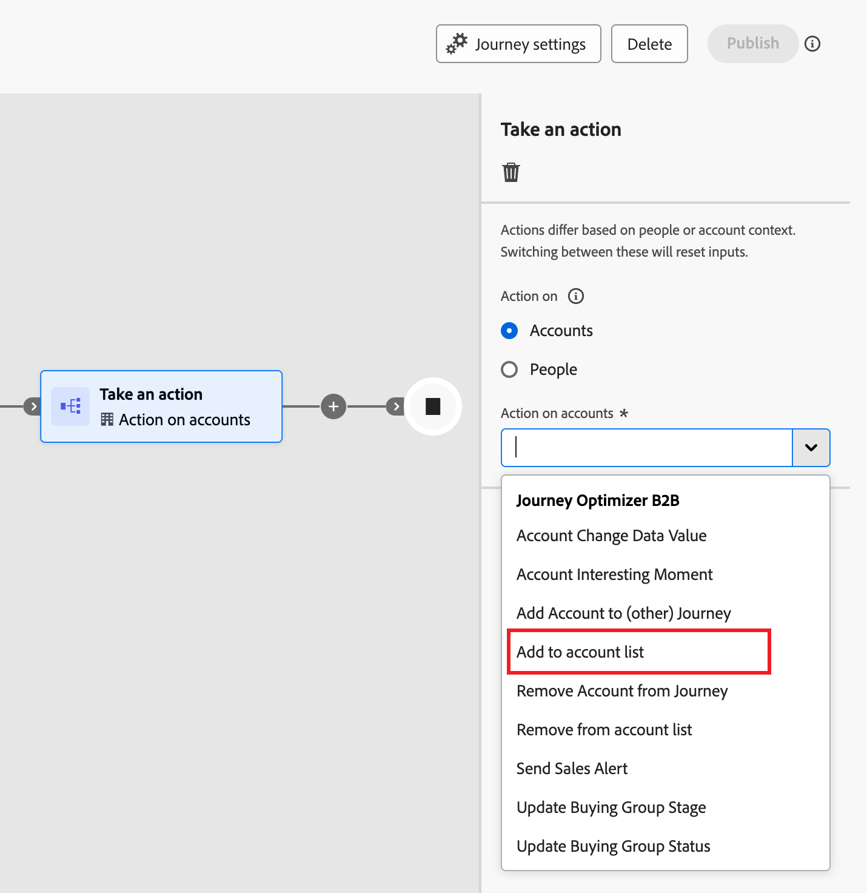
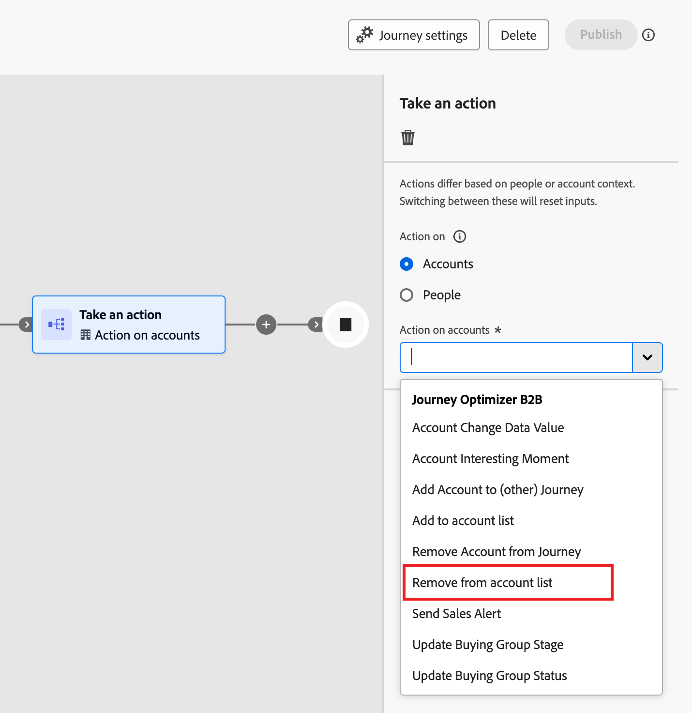

# Use account lists in journeys

There are multiple ways that you can incorporate Live (published) account lists into your account journeys.

## Account audience node

All account journeys start with an [_Account audience_ node](../journeys/account-audience-nodes.md). When you set this node to use an account list, the member accounts move through the journey when it goes live (published).

1. Select the **[!UICONTROL Account list]** option for the starting _Account audience_ node.

   {width="500"}

1. Click **[!UICONTROL Add account list]**.

1. Select the checkbox for the account list and click **[!UICONTROL Save]**.

   {width="600" zoomable="yes"}

## Take an action node - Add to account

**_Static account lists only_**

Within an account journey, add accounts to a static account list using [a _Take an Action_ node](../journeys/action-nodes.md).

For example, you have a journey path where you send an email and some accounts take various actions as a response. You consider this activity to be a qualification point in the journey. With the qualification, you want to add them to an account list that is used as the audience for another journey with a different flow for qualified accounts.

>[!NOTE]
>
>If an account is already in the list when the node executes, the action is ignored.

1. Select the _[!UICONTROL Action on]_ **[!UICONTROL Accounts]** option.

1. For _[!UICONTROL Action on accounts]_, choose **[!UICONTROL Add to account list]**.

   {width="500"}

1. For **[!UICONTROL Select live static account list]**, choose the account list where you want to add accounts.

   {width="500"}

## Take an action node - Remove from account

**_Static account lists only_**

Within an account journey, remove accounts from a static account list using [a _Take an Action_ node](../journeys/action-nodes.md).

For example, you have a journey path where you send an email and some accounts take various actions as a response. You consider this activity to be a qualification point in the journey. With this qualification, you want to remove them from an account list. This list is used as the audience for another journey that sends additional emails so that you don't duplicate your qualification communications.

>[!NOTE]
>
>If an account is not in the list where it is scheduled for removal, the action is ignored.

1. Select the _[!UICONTROL Action on]_ **[!UICONTROL Accounts]** option.

1. For _[!UICONTROL Action on accounts]_, choose **[!UICONTROL Remove from account list]**.

   {width="500"}

1. For **[!UICONTROL Select live static account list]**, choose the account list where you want to remove accounts.

   {width="500"}

## Split paths node - Account member of account list {#split-paths-account-member-of-account-list}

**_Account journeys only_**

Use the _[!UICONTROL Account Member of Account List]_ filter in a [_Split paths_ node](../journeys/split-merge-paths-nodes.md#add-a-split-path-by-account-node) that splits by accounts. The account is or is not a member of one or more of the selected account lists. To include accounts in the lists, set the membership to `true`, or set it to `false` to exclude them.

To exclude accounts on a blocklist, add the _[!UICONTROL Account Member of Account List]_ filter, set membership to `false`, and select the list.

1. Navigate to the journey map.

1. Click the plus ( **+** ) icon on a path and choose **[!UICONTROL Split paths]**.

1. In the node properties on the right, choose **[!UICONTROL Accounts]** for the split.

1. To define a condition for _[!UICONTROL Path 1]_, click **[!UICONTROL Apply condition]**.

1. Define the account list filter.

   * In the conditions editor, expand the _[!UICONTROL Special filters]_ folder and drag the **[!UICONTROL Account Member of Account List]** filter onto the conditions workspace.

   * To include accounts in the lists, set the membership to `true`, or set it to `false` to exclude them.

   * Select one or more account lists.

   {width="700" zoomable="yes"}

   You can combine the account list membership filter with other account filters and choose to match all conditions or any condition. Refine your conditions by applying the **[!UICONTROL Filter logic]** at the top.

1. Click **[!UICONTROL Done]**.

Continue configuring the split path node as described in [Add a split path by account node](../journeys/split-merge-paths-nodes.md#add-a-split-path-by-account-node).

## Split paths node - Person member of account list {#split-paths-member-of-account-list}

**_Person journeys only_**

Use the account list membership filters in a [_Split paths_ node](../journeys/split-merge-paths-nodes.md) of a person journey to route people based on whether their account is a member of an account list. Two filters are available:

| Filter | Description |
| ------ | ----------- |
| [!UICONTROL Person Member of Account Dynamic List] | The person's account is or is not a member of one or more dynamic account lists. |
| [!UICONTROL Person Member of Account Static List] | The person's account is or is not a member of one or more static account lists. |

To exclude people in blocklisted accounts from a nurture path, add the _[!UICONTROL Person Member of Account Static List]_ filter, set the operator to `is not`, and select the list.

1. Navigate to the journey map.

1. Click the plus ( **+** ) icon on a path and choose **[!UICONTROL Split paths]**.

1. To define a condition for _[!UICONTROL Path 1]_, click **[!UICONTROL Apply condition]**.

1. Define the account list filter

   * In the conditions editor, expand the _[!UICONTROL Special filters]_ folder and drag the **[!UICONTROL Person Member of Account Dynamic List]** or **[!UICONTROL Person Member of Account Static List]** filter onto the conditions workspace.

   * To include people whose account is in the list, set the operator to `is`, or set it to `is not` to exclude them.

   * Select one or more account lists.

      {width="700" zoomable="yes"}

    You can combine account list membership filters with other people filters and choose to match all conditions or any condition. Refine your conditions by applying the **[!UICONTROL Filter logic]** at the top.

1. Click **[!UICONTROL Done]**.

Continue configuring the split path node as described in [Add a split path by people node](../journeys/split-merge-paths-nodes.md#add-a-split-path-by-people-node).
