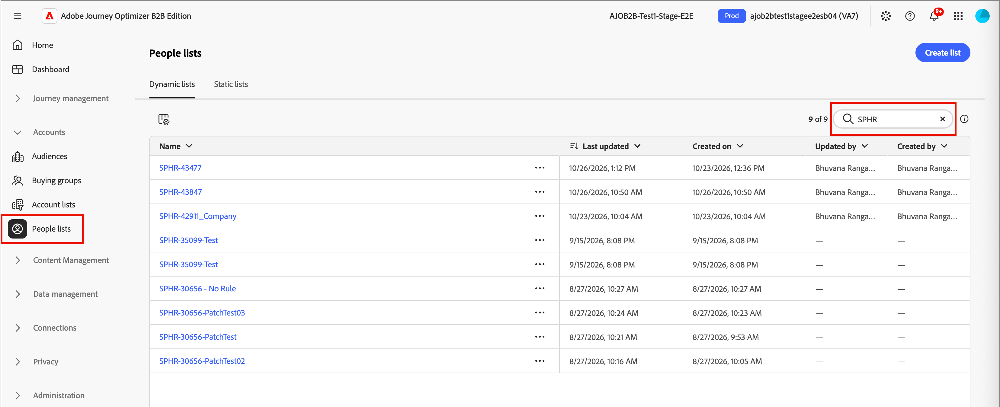

# People lists

In [!DNL Journey Optimizer B2B Edition], a people list is a person-level audience container that you use for person journey targeting. Static lists hold a fixed or journey-managed membership, and dynamic lists refresh membership automatically based on rules that you define.

## Access and browse people lists {#access-browse}

Access people lists from the left navigation to view, create, and manage list membership.

* On the left navigation, expand **[!UICONTROL Audiences]** and select **[!UICONTROL People lists]**.

   There are two tabs on the page. Select **[!UICONTROL Dynamic lists]** or **[!UICONTROL Static lists]** to switch between the two list types.

* Enter text in the _Search_ field at the top of the list to filter the displayed list by name.

   {width="800" zoomable="yes"}

* Click the _Column settings_ (  ) icon in the top-right corner to select or clear the displayed columns.

From this page, you can also:

* Create new dynamic and static lists lists.
* Open a list to review current membership.
* Apply membership filters.

## Create a people list {#create-people-list}

1. Click **[!UICONTROL Create list]** at the top right of the _[!UICONTROL People lists]_ page.

   {width="450"}

1. Enter a **[!UICONTROL Name]** (required) and a **[!UICONTROL Description]** (optional) for the list.

1. Choose the list **[!UICONTROL Type]**:

   * [**[!UICONTROL Static]**](#static-lists) - Membership is determined by qualifying filters evaluated when you create the list. Membership does not update unless you manually qualify or disqualify members.
   * [**[!UICONTROL Dynamic]**](#dynamic-lists) - Membership is determined dynamically by qualifying filters. Membership refreshes automatically.

1. Click **[!UICONTROL Create]**.

## Static lists {#static-lists}

Static list membership is defined by simple filters that reference person attributes and activities. Membership does not change unless you manually qualify or disqualify members.

>[!NOTE]
>
>Static list filter definitions apply only once, when you add members to or remove members from the list. The defined filter is not available afterward. If you want to maintain a consistent audience definition using filters, use a dynamic list instead.

### Add members {#static-list-add-members}

1. Open the static list and click **[!UICONTROL Add people]** at the top right.

1. In the _[!UICONTROL Add people]_ dialog, define the rules for qualifying profiles by dragging filters from the left panel.

   Filter profiles using any combination of:

   * Activity history
   * Experience Platform enabled person fields
   * Custom fields
   * Intent data
   * Person attributes
   * Special filters, such as journey membership

   For each filter that you add, click **[!UICONTROL Add constraints]** to refine the matching criteria.

   {width="800" zoomable="yes"}

1. Click **[!UICONTROL Done]** to save your changes.

1. Select the **[!UICONTROL Members]** tab.

   Qualifying members appear in the list after a brief delay.

   <!-- 
   not working yet

   {width="700" zoomable="yes"}

   -->

### Remove members {#static-list-remove-members}

1. Open the static list and click **[!UICONTROL Remove people]** at the top right.

1. In the _[!UICONTROL Remove people]_ dialog, add filters to match the members that you want to disqualify.

   <!-- 
   not working yet

   {width="700" zoomable="yes"}

   -->

1. Click **[!UICONTROL Done]** to save your changes.

1. Select the **[!UICONTROL Members]** tab.

   The disqualified members leave the list after a brief delay.

### Activate to a destination {#static-list-activate}

Activating a static people list sends its membership to a connected destination, with ongoing sync instead of a one-time export. This is useful for paid media targeting, suppression, and downstream orchestration.

* The static list acts as a container for the people.
* The activation sends and syncs that membership to a destination.
* People added to the list later are propagated automatically.
* People removed later are deactivated automatically.

>[!PREREQUISITES]
>
>You must have one or more configured destinations for your [!DNL Journey Optimizer B2B Edition] sandbox before you can activate a static list to a destination.

1. Select the **[!UICONTROL Static lists]** tab.

1. Locate the static list that you want to activate, click the _More menu_ ( **...** ) icon next to the list, and choose **[!UICONTROL Activate to destination]**.

   <!--
   {width="450"}
   -->

   You can also open the static list and use the **[!UICONTROL More]** menu at the top right.

1. Select the check box for the configured destination connection.

   <!-- 
   {width="600" zoomable="yes"}
   -->

1. Click **[!UICONTROL Save]**.

1. In the _[!UICONTROL Activate list to destination]_ dialog, click **[!UICONTROL Activate]** to confirm.

When activation completes, a confirmation message appears and the destination shows as **[!UICONTROL Active]** on the **[!UICONTROL Destinations]** tab of the list. You can activate a static list to more than one destination at a time. Membership syncs to all of them.

To review the destinations that a static list is activated to, open the list and select the **[!UICONTROL Destinations]** tab.

#### Deactivate a destination {#deactivate-destination}

Remove a destination connection from a static list when you no longer want its membership synced downstream.

1. Open the static list and select the **[!UICONTROL Destinations]** tab.

1. Use the row action to remove the destination that you want to disconnect.

1. Confirm in the _[!UICONTROL Deactivate destination]_ dialog.

Deactivating removes the destination from the list. The people in the list are also removed from the connected destination audience.

## Dynamic lists {#dynamic-lists}

Dynamic list membership is defined using simple filters that reference person attributes and activities. Membership is maintained automatically as profiles qualify and disqualify according to the filter logic.

### Set membership rules {#set-membership-rules}

1. Open the dynamic list and select the **[!UICONTROL Rules]** tab.

1. Click **[!UICONTROL Edit rules]**.

   <!-- 
   {width="550" zoomable="yes"}
   -->

1. In the dialog, define the rules for qualifying profiles by dragging filters from the left panel.

   Qualify profiles for the list using any combination of:

   * Activity history
   * AEP enabled person fields
   * Custom fields
   * Intent data
   * Person attributes
   * Special filters, such as journey membership

   For each filter that you add, click **[!UICONTROL Add constraints]** to refine the matching criteria.

   <!-- 
   {width="700" zoomable="yes"}
   -->

1. Click **[!UICONTROL Done]** to save your changes.

1. Select the **[!UICONTROL Members]** tab.

   Qualifying members appear in the list after a brief delay.

   <!-- 
   {width="700" zoomable="yes"}
   -->

   Click the name of a person in the list to open the [person details](../accounts/person-details.md) page, where you can view their summary and recent activities.

### Duplicate a dynamic list {#duplicate-dynamic-list}

Duplicating a dynamic list replicates its membership filtering so that you can reuse it in a different context.

1. In the _[!UICONTROL Dynamic lists]_ tab, click the _More menu_ ( **...** ) icon next to the list and choose **[!UICONTROL Duplicate]**.

1. Enter a unique **[!UICONTROL Name]** (required) and a **[!UICONTROL Description]** (optional).

   By default, the dialog appends `_copy` to the name of the originating list. Enter a different unique name as needed.

   <!-- 
   {width="375"}
   -->

1. Click **[!UICONTROL Duplicate]**.
