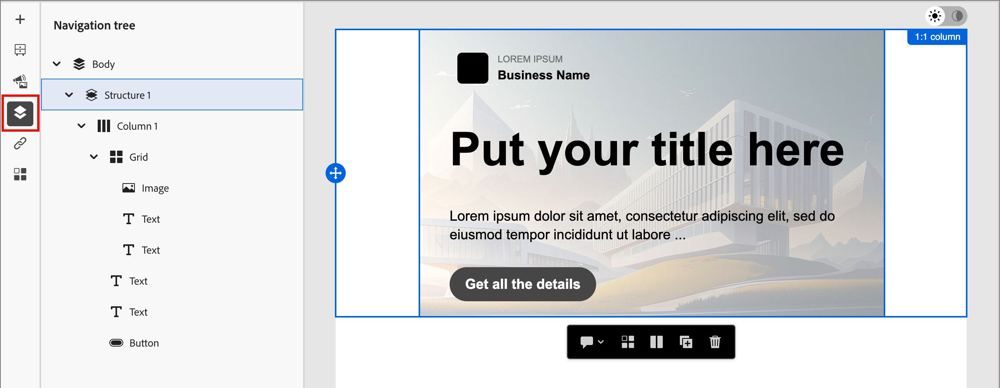

# Content modules

Use modules in [!DNL Adobe Journey Optimizer B2B Edition] to assemble content from prepared layouts. Each module combines [structure](./structure-components.md) and [content components](./content-components.md) with default content that you replace with your own text, images, and links.

Unlike individual content components, modules provide complete sections like headers, banners, cards, and footers. Add a module to the canvas, then customize its components instead of building each section from an empty space.

Modules are different from [visual fragments](./fragments.md). A module becomes part of the content that you are designing. A visual fragment is a saved content asset that you can reuse across emails and email templates.

## Supported content types

Use the **[!UICONTROL Modules]** tab in the visual design space for any of the following content types:

| Content type | Open the visual design space |
| --- | --- |
| Email | [Create or edit email content](./email-authoring.md). |
| Landing page | [Create or edit a landing page](./landing-page-design.md). |
| Visual fragment | [Create or edit a fragment](./fragment-authoring.md). |
| Email template | [Create or edit an email template](./email-template-authoring.md). |
| Landing page template | [Create or edit a landing page template](./landing-page-template-design.md). |

{width="600" zoomable="yes"}

## Add and customize modules

Start with a module that matches the section you want to create, then adapt its content and styling.

1. Open your email, landing page, visual fragment, or template in the visual design space.

   At the left of the canvas, the **[!UICONTROL Modules]** tab is displayed by default.

1. To review the available layouts, expand a category.

   You can also use the search field to find a module by name.

1. Drag a module onto the canvas.

   {width="600" zoomable="yes"}

1. Review the elements within the module.

   Each module includes default content that you can edit. Click the _Navigation tree_ icon (  ) to the left of the canvas to display the structure and elements in the module.

   {width="600" zoomable="yes"}

1. Select an element in the module to customize it.

   You can replace the default text, choose images from your assets, and update links for your content.

   Use the **[!UICONTROL Settings]** and **[!UICONTROL Styles]** tabs to adjust the selected component.

   {width="600" zoomable="yes"}

1. To add another element, select the **[!UICONTROL Components]** tab and drag a [content component](./content-components.md) into the module.

   If you add a component to the module structure, it inherits the module styling by default. Adjust their styles as needed.

   {width="800" zoomable="yes"}

1. Select **[!UICONTROL Save]** to save your changes.

>[!NOTE]
>
>When a brand theme is applied to email content, modules inherit its styles. To set up themes and override styles, refer to [Use a theme for email content authoring](./brand-themes.md#use-email-theme).

## Module categories

Expand a category to choose a layout variant. Variants provide different arrangements of the section content, such as layouts with one, two, or three columns.

| Category | Use |
| --- | --- |
| [!UICONTROL Headers] | Introduce your content with a logo, navigation links, and introductory text. |
| [!UICONTROL Hero] | Highlight an announcement or promotion with a banner section. |
| [!UICONTROL Testimonial] | Present customer quotes in a styled section. |
| [!UICONTROL Cards] | Arrange products, articles, or other content items in a grid. |
| [!UICONTROL Teams] | Introduce team members, authors, or speakers with photos, names, and roles. |
| [!UICONTROL Footers] | Finish your content with navigation links, social links, and legal text. |

Replace default links and text with content appropriate for your channel. For marketing emails, include an opt-out link and [check email alerts](./add-email.md#check-alerts) before publishing the journey.

## Reuse customized module content

To reuse a customized module from an email or email template, [save the content as a visual fragment](./fragments.md#save-a-new-fragment-from-email-or-template-content). Then insert the fragment into other emails or email templates.

For modules added while authoring a visual fragment, save and [publish the fragment](./fragments.md#create-fragments). This makes it available for reuse.
