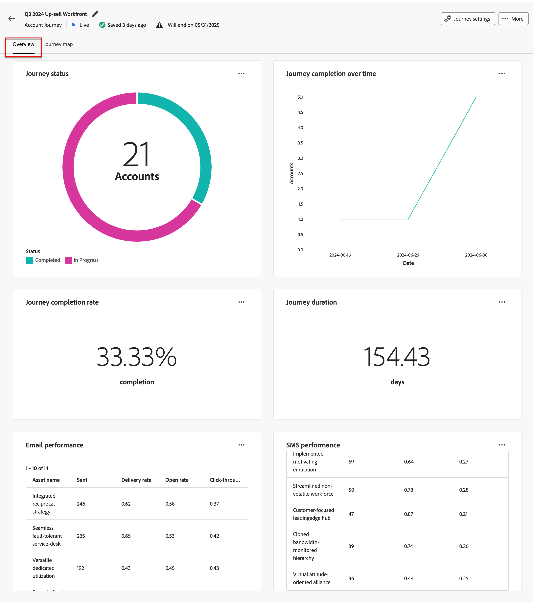
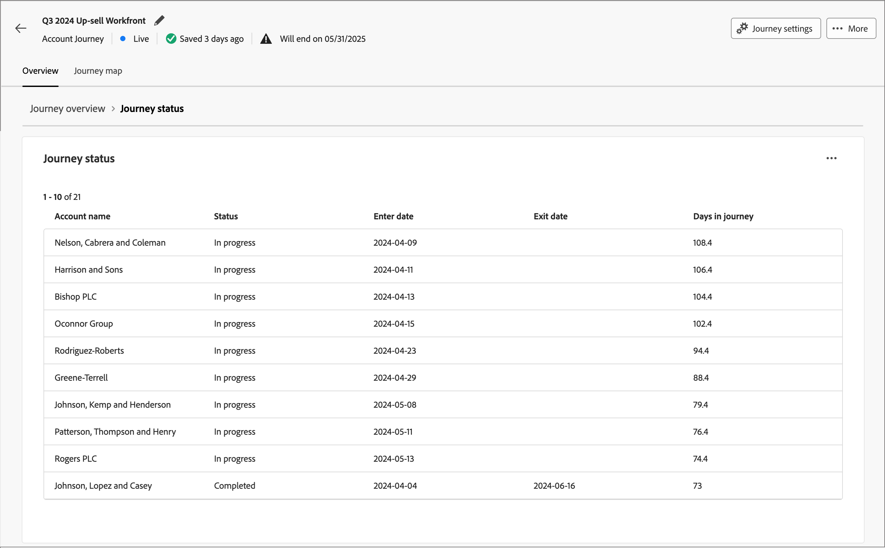
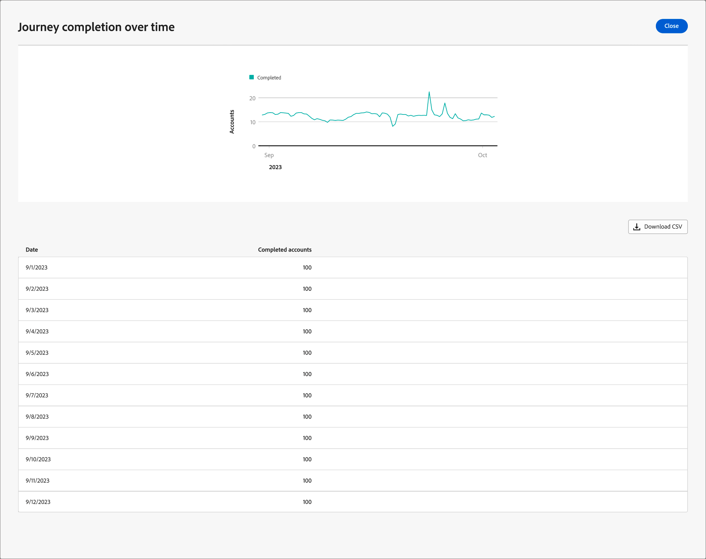

# Journey details

In [!DNL Adobe Journey Optimizer B2B Edition], open a published account or person journey and select the **[!UICONTROL Overview]** tab. Review progress, engagement, and channel performance for the selected journey.

Account journeys report progress for accounts. Person journeys report progress for people. The available widgets and metric labels differ by journey type. Select the corresponding tab for dashboard details.

For email metrics aggregated across journeys, use the [Email performance report](../dashboards/email-performance-dashboard.md).

>[!BEGINTABS]

>[!TAB Account journeys]

The account journey dashboard shows account progress, engagement, channel performance, and generative AI summaries. It takes approximately four hours for data to start populating the charts and tables.

{width="700" zoomable="yes"}

## Journey completion

This section presents two completion metrics:

* **[!UICONTROL Status of accounts in the journey]**: Shows the total account count and a breakdown by journey status, including _Completed_, _In Progress_, and _Aborted_. Each segment displays a status, percentage, and account count.
* **[!UICONTROL Completed accounts over time]**: Shows the number of accounts that completed the journey over time. The horizontal axis shows dates, and the vertical axis shows account counts.

>[!NOTE]
>
>In account journeys, the **[!UICONTROL Status of accounts in the journey]** chart includes accounts that went through the journey, even if they were subsequently deleted. **[!UICONTROL Drill through]** excludes deleted accounts, so it can show fewer records than the chart. This difference is expected. Deleting accounts does not change the historical journey status counts.

## Journey engagement

This section presents two engagement metrics:

* **[!UICONTROL Engagement by accounts]** - This circle chart segments the accounts in a journey into _Engaged_ and _Not engaged_ categories. The central figure displays the total count. This visualization provides a quick understanding of overall account engagement.
* **[!UICONTROL Engagement by people]**: Shows the number of people with engagement activities in the journey. This value counts people, not engagement activities.

## Journey performance

This section presents two vital metrics:

* **[!UICONTROL Journey completion rate]** - The percentage of accounts that have successfully completed their journey.
* **[!UICONTROL Average journey completion time]**: The average time that accounts took to complete the journey, displayed in days.

## Channel performance {#email-and-sms-performance}

The dashboard includes **[!UICONTROL Email performance]**, **[!UICONTROL SMS performance]**, and **[!UICONTROL WhatsApp performance]** tables for the selected account journey. Use the available delivery and engagement metrics to assess each communication touchpoint.

**[!UICONTROL Email performance]** table columns:

* _[!UICONTROL Asset name]_ - Name of the asset
* _[!UICONTROL Sent]_ - Number of emails sent
* _[!UICONTROL Delivery rate]_ - Number of delivered emails divided by the number sent
* _[!UICONTROL Open Rate]_ - Number of opened emails divided by the number delivered
* _[!UICONTROL Click-through rate]_ - Number of clicked emails divided by the number delivered

**[!UICONTROL SMS performance]** table columns:

* _[!UICONTROL Asset name]_ - Name of the asset
* _[!UICONTROL Sent]_ - Number of SMS messages sent
* _[!UICONTROL Delivery rate]_ - Number of delivered SMS messages divided by the number sent
* _[!UICONTROL Click-through rate]_ - Number of clicked SMS messages divided by the number delivered
<!--
To generate a shareable PDF of your current view, click **[!UICONTROL Export]** at the top right of the page. 
-->

## Additional actions

Use the **...** menu for a chart or table to access its available actions.

### Drill through

For the **[!UICONTROL Status of accounts in the journey]** chart, choose **[!UICONTROL Drill through]** for an in-depth analysis of individual account statuses.

{width="600" zoomable="yes"}
<!--
The applied global filters are carried over to the view and displayed at the top. Click the _Filter_ icon at the top left to filter the data display by journey.
-->

### View more

Choose **[!UICONTROL View more]** to access extended data. The displayed pop-up provides a breakdown of the data. 

{width="600" zoomable="yes"}

To download the data, select **[!UICONTROL Download CSV]**. To return to the _[!UICONTROL Overview]_ dashboard, select **[!UICONTROL Close]**.

>[!TAB Person journeys]

The person journey dashboard shows completion, engagement, and email performance for people in the selected journey.

## Journey completion {#person-journey-completion}

Use the following charts to review the status of people in the journey and completion trends:

* **[!UICONTROL Status of people in the journey]**: Shows the total number of people and a breakdown by journey status. Each segment displays a status, percentage, and people count.
* **[!UICONTROL Completed people over time]**: Shows the number of people who completed the journey over time. The **[!UICONTROL Incremental completed]** series shows completions for each time interval. The **[!UICONTROL Cumulative completed]** series shows the running total of completions.

>[!NOTE]
>
>In person journeys, the **[!UICONTROL Status of people in the journey]** chart includes people who went through the journey, even if they were subsequently deleted. **[!UICONTROL Drill through]** excludes deleted people, so it can show fewer records than the chart. This difference is expected. Deleting people does not change the historical journey status counts.

## Journey engagement {#person-journey-engagement}

The **[!UICONTROL Engagement by people]** widget shows the number of people with engagement activities in the journey. This value counts people, not engagement activities.

## Journey performance {#person-journey-performance}

Use the following metrics to review completion performance:

* **[!UICONTROL Journey completion rate]**: The percentage of people who completed the journey.
* **[!UICONTROL Average journey completion time]**: The average time that people took to complete the journey, displayed in days.

## Email performance {#person-journey-email-performance}

The **[!UICONTROL Email performance]** table shows counts for each email asset in the selected person journey, rather than rates:

* **[!UICONTROL Asset name]**: Name of the email asset
* **[!UICONTROL Sent]**: Number of emails sent
* **[!UICONTROL Delivered]**: Number of emails delivered
* **[!UICONTROL Opened]**: Number of emails opened
* **[!UICONTROL Clicked]**: Number of emails clicked

## Drill through {#person-journey-drill-through}

For the **[!UICONTROL Status of people in the journey]** chart, open the **...** menu and select **[!UICONTROL Drill through]** to review individual person statuses.

>[!ENDTABS]
