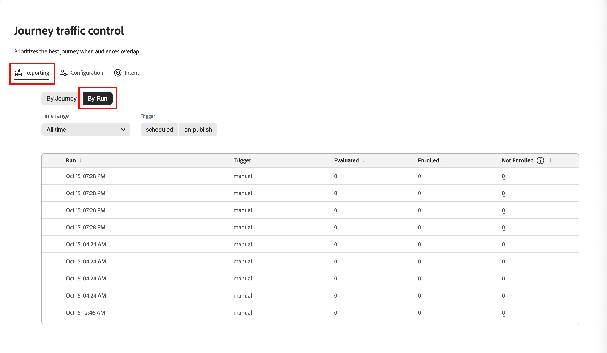

# Journey traffic control

In [!DNL Adobe Journey Optimizer B2B Edition], audiences overlap often. A marketing director at a financial services firm could qualify for your industry journey, your product interest journey, and your enterprise account journey on the same day. Without coordination, that person is enrolled in all three and receives competing or redundant messages. Use _Journey traffic control_ to enroll each person in the one person journey that fits them best when they qualify for more than one journey at the same time. 

Journey traffic control reviews every person who qualifies for more than one participating journey. It compares what you know about the person with each journey purpose, and enrolls the person in the best match. A person who qualifies for only one journey is enrolled in that journey. A person who qualifies for none is not enrolled.

## Benefits of journey traffic control {#benefits}

Journey traffic control replaces manual overlap management with a recorded, fit-based decision for each person.

| Without journey traffic control | With journey traffic control |
|---|---|
| A person who matches several audiences is enrolled in several journeys and receives overlapping messages. | Each person is enrolled in at most one participating journey for each evaluation. |
| Teams manage overlap by hand with exclusion segments and audience rules. These rules get harder to maintain with every new journey. | The system chooses based on fit. You do not build or maintain exclusion logic. |
| It is hard to explain why a person received a given journey. | Every decision is recorded and viewable, including the score for each competing journey. |
| Message fatigue and mixed messaging reduce engagement. | Each person gets one relevant, consistent experience. |

## Usage examples {#examples}

Use journey traffic control when your journeys target overlapping audiences. For example:

* **Industry nurture programs**: You run separate journeys for Financial Services, Healthcare, and Manufacturing. A contact has no industry value, but their profile is linked to a bank's account. Journey traffic control matches the contact to the Financial Services journey instead of enrolling them in all three.
* **Product interest campaigns**: You run one journey for each product line. A prospect with recent interest signals in two products is enrolled in the journey for the product with the strongest interest.
* **Role-based messaging**: You run one journey for technical evaluators and another for executive sponsors. A person's job title and function decide which journey they join.
* **Enterprise and SMB programs**: You run different journeys by company size. A contact's customer segment and account information decide which journey they join.
* **New journey launches**: You publish a new journey into an audience that other journeys already cover. Journey traffic control evaluates the overlap, so you do not redesign existing audience rules.

## Selection by fit {#dimensions}

When a person qualifies for more than one journey, journey traffic control compares the person's profile with the name and description of each candidate journey. The comparison covers four dimensions.

| Dimension | What is compared |
|---|---|
| Industry | The person's industry. If the industry is missing, the industry of the linked account. |
| Functional fit | The person's role and job function. |
| Company size | The person's customer segment, account type, and spending context. |
| Intent | The product for which the person has shown the strongest recent interest. |

Keep the following points in mind:

* **Journey names and descriptions matter.** They tell the system what each journey is for. Specific, accurate descriptions produce better matches.
* **Missing data is skipped, not guessed.** If a person has no value for a dimension, journey traffic control leaves that dimension out for that person. It makes the decision on the dimensions that have data.

The decision record for each person in the reporting views shows the score for every competing journey and the dimensions used. A dimension without data is marked as excluded.

### Comparisons {#comparisons}

For each dimension, journey traffic control compares the person's relevant text, such as a job title, with each journey's description. It uses two methods:

* **Meaning similarity**: Does the text mean something close to the description?
* **Keyword matching**: Does the text use the same terms as the description?

The stronger result of the two methods becomes the journey's score for that dimension.

Each dimension then proposes its best-scoring journey, but only if the score clears a minimum quality threshold. Journeys without a qualifying proposal are dropped. The weights you configure rank the remaining journeys by their combined weighted scores. The journey with the highest score is selected. The winner is not necessarily the journey with the most proposals. One strong match on a single dimension is more significant than several weaker matches.

Each decision record stores the following information:

* The selected journey and the competing journeys
* The scores for each dimension and the combined score
* A confidence value
* An agreement level of High, Medium, or Low, which shows how many dimensions supported the winner

<!-- CONFIRM with Engineering: whether to describe the fallback when no dimension produces a qualifying match. The source says the person is still enrolled in one eligible journey, selected consistently, with a 0% (Low) confidence decision record. Also confirm how "consistent" should be phrased. -->

## Configuration {#configuration}

To set the journey traffic control dimension weights and simulate scoring:

1. On the left navigation, go to **[!UICONTROL Journey management]** > **[!UICONTROL Journey traffic control]**.

1. Select the **[!UICONTROL Configuration]** tab.

{width="800" zoomable="yes"}

### Adjust dimension weights {#weights}

By default, all four dimensions have a weight of _Medium_ and contribute equally, at 25% each. Adjust the weights to change how much each dimension influences decisions. 

1. For each dimension, set the weighting level:

   * **[!UICONTROL Off]**
   * **[!UICONTROL Low]**
   * **[!UICONTROL Medium]**
   * **[!UICONTROL High]**

   The percentage on each card shows the share of that dimension after your settings are combined. To remove a dimension from decisions, set it to **[!UICONTROL Off]**.

   {width="600"}

   The percentage shown on each card is the normalized contribution of that dimension after combining all your selections, always totaling 100%. If you raise one dimension, the system automatically re-normalizes the others so the total stays at 100%.

   You can click **[!UICONTROL Reset to equal]** to return all dimensions to an even weighting.

1. When you want to apply the adjusted weights, select **[!UICONTROL Save weights]**.

### Simulate scoring {#simulate-scoring}

Before committing weights to production, you can simulate how traffic control would behave with those changes. Simulation does not require journey traffic control to be enabled. It evaluates profiles that are already in your live journeys and applies the traffic control logic to them. Then you can judge whether the outcomes look right for the weight settings.

Click **[!UICONTROL Simulate scoring]**.

The results header summarizes the run:

* **Profiles evaluated** — how many profiles were scored, and across how many journeys.
* **Average conflicts/profile** — the average number of competing journeys per profile.
* **Average match score** — the average confidence of the selected journeys.

{width="700" zoomable="yes"}

Each evaluated profile appears as a card showing the selected journey, key rationale, intent signals, and match score. Select a profile to open a detail view with:

* **Match score** — The overall match, with a color-coded breakdown by dimension.
* **Scores by journey** — The journeys this person qualified for, which one was selected, and why.
* **Dimensions considered** — The dimension data that drove the decision, expandable to show the underlying signals.

{width="450" zoomable="yes"}

If needed, adjust the dimension weights and click **[!UICONTROL Run again]** to re-run the simulation.

You can also click **[!UICONTROL Sample new people]** to re-run the simulation using a new random sample. 

When you are satisfied with the outcome, you can click **[!UICONTROL Save weights]** to commit the weights. New traffic control decisions use the new settings immediately, but past decisions are not affected. The weights you tested appear on the main _[!UICONTROL Configuration]_ tab and are used for any journeys traffic control is evaluating in your live environment.

You can also leave the page without applying the weights.

## Review reporting {#reporting}

Use the reporting views to see how journey traffic control enrolled people. Review decisions by journey or by run.

### Reporting by journey {#reporting-by-journey}

The **[!UICONTROL By Journey]** view summarizes the journeys under traffic control.

| Metric | Description |
|---|---|
| Governed journeys | Journeys that participate in traffic control. |
| Contested journeys | Journeys that share people with at least one other journey. |
| Profiles contested | Distinct people claimed by two or more journeys. |
| People enrolled | Distinct people enrolled. |

For each journey, the view also shows the following values:

* **[!UICONTROL Enrolled]**: The total number of people enrolled.
* **[!UICONTROL Uncontested]**: People who qualified for only this journey.
* **[!UICONTROL Won]**: People who qualified for several journeys and were enrolled in this one.
* **[!UICONTROL Win rate]**: How often the journey won when people competed for it.

{width="700" zoomable="yes"}

Filter the list by [journey status](./journeys-overview.md#journey-status): [!UICONTROL Live], [!UICONTROL Finished], [!UICONTROL Aborted], or [!UICONTROL All].

To see where the contested people of a journey ended up, open the journey. The detail view shows the journeys that people were enrolled in instead. To see the match score, the competing journeys, the score for each, and the dimensions used, expand the decision record of any enrolled person. Search by name, lead ID, or profile ID.

{width="700" zoomable="yes"}

To compare how industry or intent product distributes across journeys, select **[!UICONTROL Compare journeys]** and choose at least two and up to 20 live journeys.

<!-- Figure placeholders: By Journey overview, journey detail "Where contested profiles landed", and a decision record. Redact person names and use clean sample journey names without test prefixes. Choose runs with healthy enrollment counts. -->

### Reporting by run {#reporting-by-run}

Select **[!UICONTROL By Run]** to view a list of each evaluation run with the following information:

* The time of the run
* How the run was triggered: *scheduled*, *on-publish*, or *manual*
* The number of people evaluated, enrolled, and not enrolled

{width="700" zoomable="yes"}

Filter the list by time range (24 hours, 7 days, 30 days, or all time) and trigger type.

To see a flow diagram from the evaluated people to the journeys they were enrolled in, open a run. A breakdown for each journey shows how many people were **[!UICONTROL Not Enrolled]**, **[!UICONTROL Enrolled]**, **[!UICONTROL Arbitrated]** (chosen among competing journeys), and **[!UICONTROL Uncontested]**. For any journey in a run, you can also view the people evaluated, their outcomes, the journeys they competed with, and their match scores.

{width="500" zoomable="yes"}

<!-- CONFIRM with Product: what the scheduled and on-publish triggers mean for customers, and the content of the Not enrolled tooltip. -->

## Evaluation run process {#run-process}

Each run follows the same sequence. Journey traffic control reads only data already present in your [!DNL Journey Optimizer B2B Edition] environment and does not require additional data sources.

1. Journey traffic control waits for the person and account [profile refresh](../data/data-availability-timing.md#daily-refresh) in your environment to complete successfully. If the refresh fails, no run starts on stale data.

1. Audience membership is calculated in [!DNL Adobe Experience Platform] and [synchronized](../data/data-availability-timing.md#platform-sync) to [!DNL Journey Optimizer B2B Edition]. After segmentation finishes, the system waits for the synchronization to complete, for up to four hours. If the synchronization finishes sooner, processing starts immediately. If four hours pass first, processing starts anyway. If the synchronization finishes later, a new run starts on the updated data.

1. The system assembles the candidate journeys. Only journeys that are live and enabled for traffic control participate. The system reads each journey's status, name, and description.

1. The system reads audience membership and profile context in small batches.

1. The system checks eligibility. A person is eligible for a journey only when all of the following are true:

   * The journey is live and enabled for traffic control.
   * The person is currently a member of the journey's audience.
   * The person has not previously been successfully enrolled in that journey.
   * The person is not currently enrolled in that journey.

1. The system selects a journey. A person with one eligible journey is enrolled in it. A person with no eligible journey is not enrolled. For a person with several eligible journeys, the system compares the person's profile with each journey's name and description across the [four dimensions](#dimensions).

1. The system submits the enrollment to the selected journey through the standard journey enrollment mechanism.

1. The system saves each decision and enrollment result for reporting and audit.

1. The system checkpoints progress as batches finish, records the outcome, and sends a completion notification.

## Data used and stored {#data}

Journey traffic control uses the following data from your environment.

| Data | Source | Use |
|---|---|---|
| Journey status, name, and description | Your journeys | Decide which journeys participate and what each journey is for. |
| Audience membership | [!DNL Experience Platform] audiences synchronized into [!DNL Journey Optimizer B2B Edition] | Identify who qualifies for each journey. |
| Person profile, such as industry, job title and function, and customer segment | Your person data | Provide the industry, functional fit, and company size dimensions. |
| Linked account profile, such as industry and account type | Your account data | Fill in the industry when the person's own value is missing and supply account context. |
| Product interest | Your [intent data](../admin/intent-data.md) | Provide the intent dimension. The product with the strongest, most recent interest is used. |
| Enrollment history | Records written by previous runs | Avoid enrolling the same person in the same journey repeatedly. |
| Current enrollment status | [!DNL Journey Optimizer B2B Edition] | Avoid enrolling a person who is already in the journey. |

For every run, journey traffic control stores a run summary. For every enrolled person, it stores an enrollment decision record. Both are stored in the Adobe-managed data stores of your environment. They power the reports and prevent repeat enrollments.

<!-- CONFIRM with Engineering, Security, and Legal before publishing. The source material does not state any of the following data handling commitments:
- Where processing occurs and data residency.
- Whether meaning similarity comparison uses a third-party or externally hosted AI service, and whether profile text leaves the Adobe environment.
- Whether customer data is used to train models shared with other customers.
- The retention period for decision and enrollment records, and how they are deleted when a person is erased (link to privacy requests).
- Encryption in transit and at rest, role-based access to the reports, and tenant isolation. -->

## Set up journey traffic control {#setup}

You can enable journey traffic control directly on an individual [person journey](./create-publish-journey.md) when it is in _Draft_ status.

1. Make sure that the person journey has a name and description that provides a clear purpose and goal for the journey.

   These names and descriptions are the basis for matching.

1. Click **[!UICONTROL ... More]** at the top right of the journey canvas and choose **[!UICONTROL Journey traffic control settings]**.

   {width="400"}

1. In the dialog, enable the **[!UICONTROL Enable journey traffic control]** option.

   The settings dialog explains the behavior: when enabled, the journey becomes a candidate, and the model evaluates and recommends the most suitable journey for a person qualifying for multiple active journeys.

   {width="450"}

   >[!IMPORTANT]
   >
   >The toggle can be changed at any time while the journey remains in _Draft_ status. After you publish the journey with journey traffic control enabled, it evaluates entry into that journey, and you can no longer disable the setting.

1. Click **[!UICONTROL Save]**.

1. [Publish](./create-publish-journey.md#publish-a-journey) the person journey.

## Limitations and dependencies {#limitations}

The following dependencies affect when and how well journey traffic control works:

* **Audience synchronization**: Decisions rely on up-to-date audience membership synchronized from [!DNL Experience Platform] to [!DNL Journey Optimizer B2B Edition]. Run timing follows segmentation and synchronization completion. It is not a fixed schedule.
* **Profile refresh**: A run starts only after the person and account profile refresh succeeds.
* **Journey metadata**: Only live journeys that are enabled for traffic control take part. The quality of matching depends on the names and descriptions you write.
* **Profile completeness**: Quality depends on the person, account, and intent data you maintain. Missing dimensions are skipped.

Journey traffic control has the following limitations:

* **One journey for each person**: A person is enrolled in at most one journey for each run.
* **Selection does not guarantee enrollment**: Until the synchronization from [!DNL Experience Platform] completes, some profiles might be evaluated without a matching Marketo person ID. The journey is selected, but enrollment might not succeed. These people appear as *Not enrolled* in run reporting.
* **No repeat enrollment**: Journey traffic control does not enroll a person in a journey that they were previously enrolled in. To let people requalify for a journey, use [journey re-entry settings](./journey-re-entry.md).
* **Not real time**: Decisions are made when a run happens, not when a profile changes.
* **Four fixed dimensions**: You can adjust the importance of industry, functional fit, company size, and intent, but you cannot add dimensions.
* **Text based matching**: Journey names and descriptions are compared with profile text. Journeys with vague, empty, or similar descriptions are harder to tell apart. Weakly differentiated journeys can produce low confidence outcomes.

Journey traffic control only decides which eligible journey a person is enrolled in. It does not change your journeys or audiences.

<!-- CONFIRM with Product and Engineering: the maximum number of governed journeys, maximum audience size for each run, supported editions and regions, and any language limitations for text matching. -->
